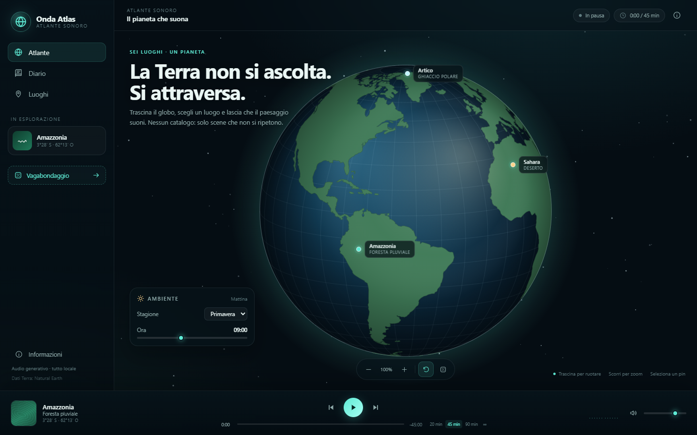
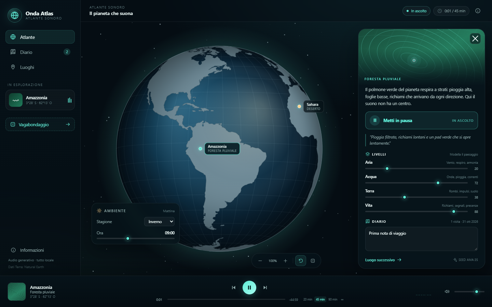
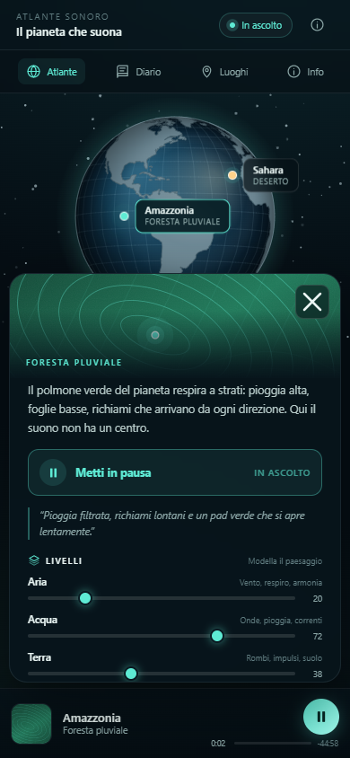
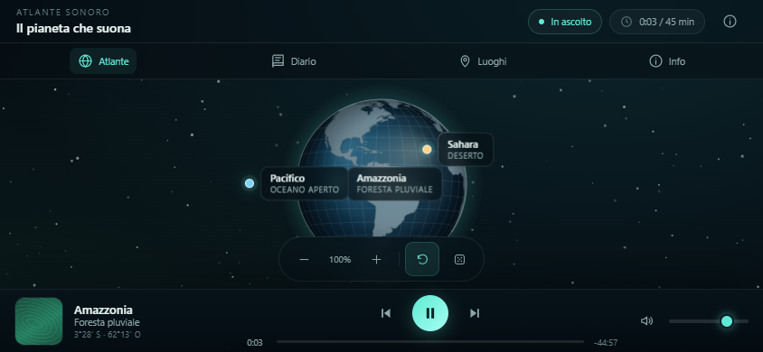

# Onda Atlas

**La Terra non si ascolta. Si attraversa.**

**Live:** https://angelolap.github.io/onda-atlas/

Un atlante sonoro del pianeta: un globo terrestre interattivo, sei luoghi reali e sei paesaggi sonori generati nel browser. Nessun catalogo, nessun account, nessuna API, nessun file audio.

Costruito come risposta creativa al test “clonare Spotify con REA”: invece di analizzare un client proprietario, qui l'idea è stata trasformata in un prodotto originale con un'identità propria.









## Cosa c'è

- **Globo terrestre reale** con proiezione ortografica, trascinamento, inerzia, zoom e rotazione automatica.
- **Sei biomi**: Amazzonia, Pacifico, Sahara, Himalaya, Artico, Tokyo notturna.
- **Audio generativo Web Audio**: rumore filtrato, pad armonici, droni e eventi casuali. Nessun campione, nessun copyright.
- **Quattro livelli** regolabili per luogo: Aria, Acqua, Terra, Vita.
- **Stagione e ora** modificano timbro, attività e luce del globo.
- **Timer di sessione** (20 / 45 / 90 min o infinito) al posto della barra di avanzamento.
- **Diario di viaggio**: visite, date e note salvate in `localStorage`.
- **Player** con trasporto, volume, visualizer e coda di luoghi.
- **UI responsive** con navigazione mobile e pannello a bottom sheet.

## Avvio

```bash
npm install
npm run dev
```

Apri `http://localhost:5173`.

Build e anteprima:

```bash
npm run build
npm run preview
```

## Mobile e PWA

Onda Atlas è installabile come app su Android e iOS:

- **Android / Chrome**: menu → “Installa app” (o “Aggiungi a Home”).
- **iOS / Safari**: Condividi → “Aggiungi a Home”.

Dopo il primo caricamento funziona **offline**: il service worker precarica shell e asset, e le navigazioni successive usano la cache.

Sul mobile:

- **pinch-to-zoom** sul globo, oltre ai pulsanti;
- pannello luogo a bottom sheet;
- safe area rispettata su iPhone (notch e barra home);
- layout dedicato in landscape;
- player con controlli a dimensione touch.

Le icone PWA si rigenerano con:

```bash
npm run icons
```

Per il deploy servono **HTTPS** (o localhost) e, se pubblichi in una sottocartella, vanno aggiornati `start_url`, `scope`, i percorsi del manifest e lo scope del service worker.

## Deploy su GitHub Pages

Il progetto è pubblicato su:

**https://angelolap.github.io/onda-atlas/**

La build per la sottocartella `/onda-atlas/` si genera con:

```bash
npm run build:pages
```

Il contenuto di `dist/` va pubblicato sul branch `gh-pages`. Il manifest usa percorsi relativi e il service worker ricava lo scope da `self.registration.scope`, quindi la stessa build funziona sia in radice sia in sottocartella.

## Test

```bash
npm run build
npm run test:e2e
```

Il test usa Chrome di sistema tramite `playwright-core` (nessun download di browser). Verifica:

- rendering del globo e presenza dei 6 pin;
- rotazione con drag e pinch-to-zoom;
- selezione di un luogo e apertura del pannello;
- avvio dell'audio (`AudioContext` in stato `running`);
- avanzamento del timer di sessione;
- cambio stagione e livello audio;
- passaggio al luogo successivo;
- diario, nota e persistenza dopo reload;
- 6 schede luogo;
- manifest e service worker attivi;
- ricaricamento **offline** dalla cache PWA;
- layout mobile, play visibile, landscape e assenza di errori in console.

Gli screenshot finiscono in `test-artifacts/`.

Se Chrome non è in `C:\Program Files\Google\Chrome\Application\chrome.exe`, modifica la costante `CHROME` in `tests/e2e.mjs`.

## Architettura

| Pezzo | Scelta |
|---|---|
| UI | React 19 + TypeScript + Vite |
| Globo | Canvas 2D + `d3-geo` (ortografica) |
| Dati Terra | `world-atlas` / Natural Earth (`land-110m`) + `topojson-client` |
| Audio | Web Audio API, sintesi originale |
| Stato | React + `localStorage` |
| Stile | CSS puro |
| Test | Playwright Core + Chrome di sistema |

### Globo

Il canvas disegna sfera oceanica, graticola, terre emerse, ombra dinamica in base all'ora e alone atmosferico. I pin sono elementi DOM sovrapposti, posizionati a ogni frame con la proiezione: restano cliccabili, accessibili da tastiera e leggibili.

La rotazione automatica si ferma quando trascini o quando un luogo è selezionato. Selezionando un luogo dal diario o dalla lista, il globo anima la rotazione fino a centrarlo.

### Audio

`src/lib/audio.ts` contiene un motore a scene:

- 4 bus di livello (`air`, `water`, `earth`, `life`);
- rumore bianco/rosa/bruno generato in memoria e filtrato;
- pad armonici con progressioni per luogo;
- droni e LFO lenti;
- eventi casuali (uccelli, onde, vento, campane, ghiaccio, città);
- crossfade tra luoghi;
- filtro e densità degli eventi influenzati da stagione e ora.

L'AudioContext viene creato al primo gesto dell'utente, come richiesto dai browser.

## Perché non è Spotify

- Non ci sono brani di terzi, catalogo o stream: solo suoni sintetizzati.
- Non ci sono account, cloud, ads o raccomandazioni.
- La navigazione è geografica, non editoriale.
- Il tempo è una sessione, non una traccia.
- Non è affiliato a Spotify e non usa loghi, icone, codice o asset del servizio.

## Dati e privacy

Tutto gira nel browser. Visite, note, volume, stagione, ora e mix dei livelli restano in `localStorage`. Nessuna chiamata di rete a runtime.

I dati geografici sono inclusi nel bundle: Natural Earth è pubblico dominio, `world-atlas` è distribuito con licenza ISC.

## Limiti

- Consigliato Chrome/Edge recenti. Firefox e Safari moderni dovrebbero funzionare, ma non sono coperti dal test automatico.
- Su iOS l'audio PWA può interrompersi quando il telefono va in standby o si cambia app: non c'è background playback garantito.
- L'installazione PWA richiede HTTPS (o localhost). Dopo un aggiornamento può servire una ricarica per rinnovare la cache del service worker.
- Il globo è una proiezione 2D, non una sfera 3D: niente inclinazione libera oltre i poli.
- L'audio è generativo e volutamente ambientale: non aspettarti brani con struttura pop.
- Il timer di sessione non è una barra di avanzamento: non si può “cercare” dentro un paesaggio infinito.
- Il diario è locale: cancellando i dati del browser si perde.

## Documentazione

La documentazione è in Markdown e commenti nel codice. **Sphinx-apidoc non è applicabile**: genera documentazione per package Python, mentre Onda è React/TypeScript.

TypeDoc sarebbe l'alternativa naturale per l'API TypeScript, ma la versione corrente non supporta ancora TypeScript 7 (usato dal progetto). Se serve un reference API, si può aggiungere TypeDoc in un secondo momento fissando TypeScript 5.x, oppure usare `ts-morph`/`api-extractor`.

## Crediti

- Natural Earth — dati geografici, pubblico dominio
- world-atlas — ISC
- d3-geo, topojson-client — ISC
- React, Vite — MIT
- Web Audio API — standard del browser

Nessun asset grafico o audio di terzi. Copertine e mappe sono SVG procedurali.
